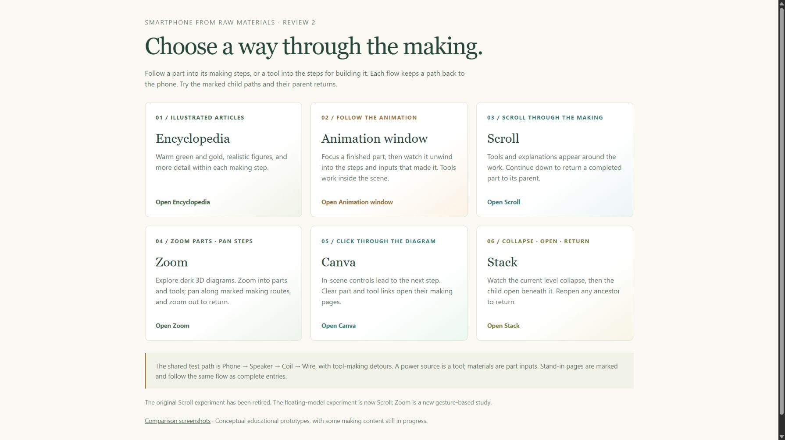
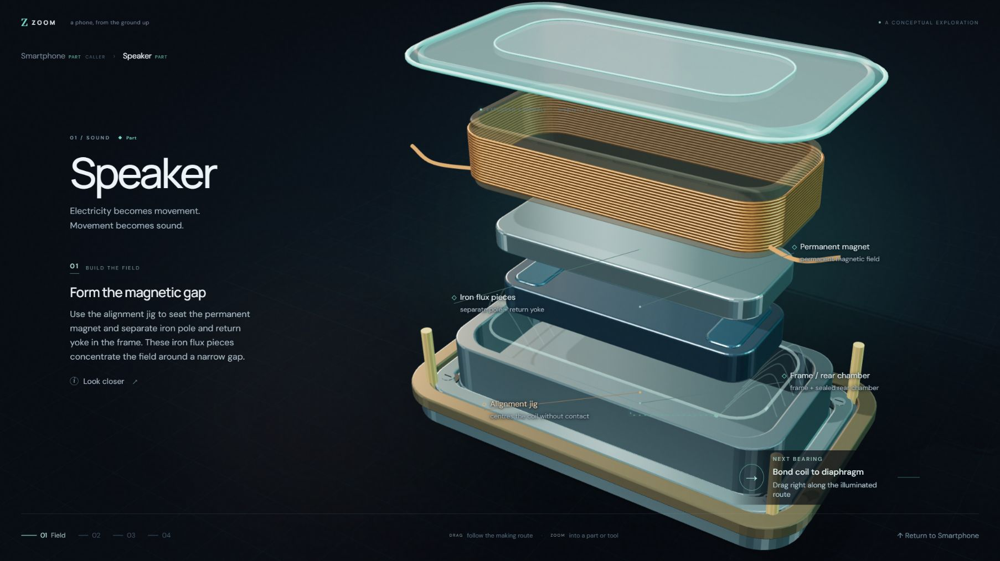

# Smartphone Prototype Lab

Six interactive ways to explore how a smartphone's parts and tools are made, using the speaker and its dependencies as a shared learning journey.




## Product idea

An illustrated encyclopedia should let a reader follow a part into its making process without losing the path back to the phone. A tool is a different relationship: it helps make the part rather than becoming part of it. The prototypes compare ways to communicate that distinction while keeping a complex dependency structure navigable on desktop and phone.

| Approach | Interaction hypothesis |
| --- | --- |
| Encyclopedia | Detailed illustrated articles with clickable parts and tools. |
| Animation window | Animate a component into its inputs and assembly steps. |
| Scroll | Progress through making steps and return to the parent as the part completes. |
| Zoom | Enter a part/tool through zoom and follow making steps by directional pan. |
| Canvas | Navigate a spatial diagram with in-scene controls and explicit hierarchy. |
| Stack | Collapse the current level and open its child beneath a persistent ancestry trail. |

## Run locally

Python 3.10+ or another static HTTP server; no build or model credentials required.

```sh
python -m http.server 8000 --bind 127.0.0.1 --directory site
```

Open http://127.0.0.1:8000. Try Phone → Speaker → Coil → Wire, follow a tool-making detour, and return to the parent step. The older `prev-next` and `scroll-retired` folders preserve additional experiments; the six cards on the landing page are the current comparison set.

## AI and research workflow

The original project used separate AI prototyping agents working from a shared brief, with first-component review before broader expansion. Scientific research, illustration generation, content review and interaction revisions supported the prototypes. [The companion research map](https://github.com/kobinkempe/smartphone-research-map) implements the structured dependency registry and validation workflow. These UI prototypes are authored separately; they do not yet consume that registry automatically.

See [docs/WORKFLOW.md](docs/WORKFLOW.md) for the complete connection between research, graph validation, map views and experience prototypes. Figure provenance is in [docs/ILLUSTRATION.md](docs/ILLUSTRATION.md). [Third-party notices](THIRD_PARTY.md).

## Scope and validation

The included static audit checks 93 files and 20 application scripts with no missing local references or JavaScript syntax errors. Desktop screenshots, the Zoom entry view and a nested learning journey are inspected in Chrome. This is a research prototype collection: conceptual geometry is enlarged for explanation, some child pages are explicitly marked stand-ins, and it is not a complete manufacturing encyclopedia. No fabrication success or learning-outcome metric is claimed.

Built with AI assistance; the demos do not call a model at runtime. [Publication review](PUBLICATION_REVIEW.md).
